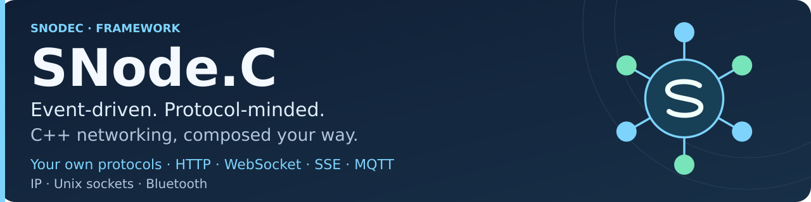
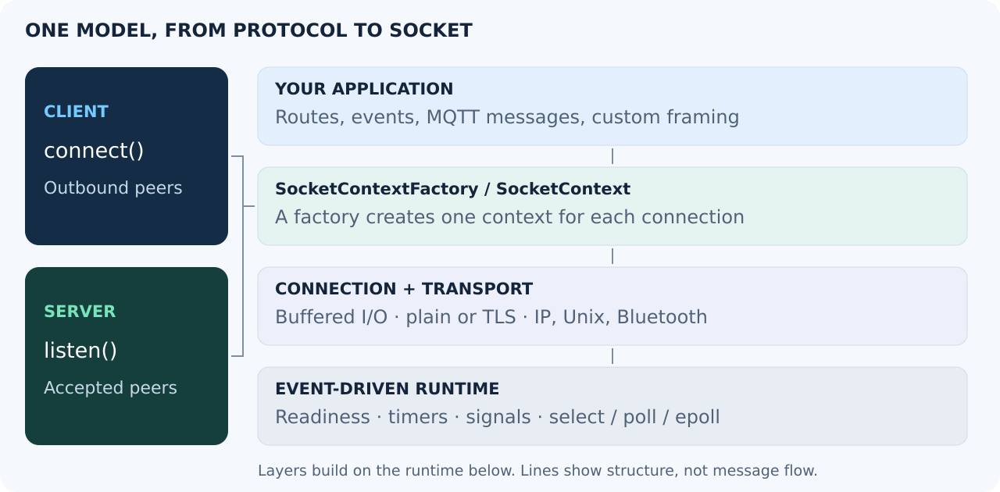
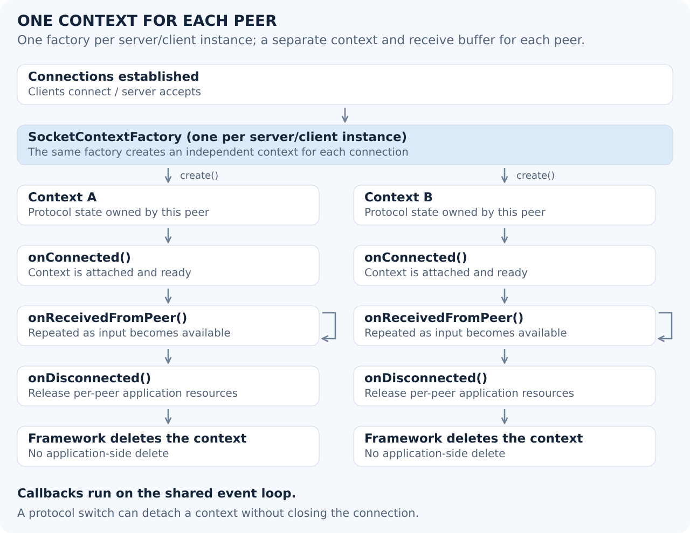

<!-- snodec:begin header -->
<a name="project-overview"></a>

<p>
<picture>
  <source media="(max-width: 600px)" srcset="docs/media/hero-mobile.svg">
  
</picture>
</p>

<!-- snodec:begin organization -->
<p><a href="https://github.com/SNodeC" title="SNodeC organization"><picture><source media="(prefers-color-scheme: dark)" srcset="docs/media/nav/organization-dark.svg"></picture></a><br clear="all"></p>
<!-- snodec:end organization -->

# SNode.C

<picture>
  <source media="(prefers-color-scheme: dark)" srcset="docs/media/snodec-chip-dark.svg">
  
</picture>
<!-- snodec:end header -->

<!-- snodec:begin status -->
[](https://github.com/SNodeC/snode.c/actions/workflows/build-and-test.yml) [](https://github.com/SNodeC/snode.c/releases) [](https://github.com/SNodeC/Packages#readme) [](LICENSE)
<!-- snodec:end status -->

**Write the protocol. Choose the connection. Build the application.**

SNode.C—Simple Node in C++—is an event-driven C++20 networking framework for Linux. Define a protocol context for each connection, reuse it in clients and servers, and choose IP, Unix-domain or Bluetooth transports. HTTP, WebSocket, SSE, MQTT and custom protocols compose through one event loop and configuration system.

<!-- snodec:begin menu -->
<p>
  <a href="#quick-start" title="Start"></a>
  <a href="#install" title="Install"></a>
  <a href="docs/guides/build-from-source.md#page-overview" title="Build"></a>
  <a href="#first-success" title="Use"></a>
  <a href="#configuration" title="Configure"></a>
  <a href="#architecture" title="Architecture"></a>
  <a href="https://snodec.github.io/snode.c-doc/html/namespacecore.html" title="API"></a>
  <a href="#contributing" title="Contribute"></a>
</p>

<!-- snodec:end menu -->

## Quick start

1. [Install](#install): get the framework and the components your program needs.
2. [Use](#first-success): run the native echo example.
3. [Configure](#configuration): review runtime settings and access controls before deployment.

## First success

### Your first program: a factory and a context

This native server and client share one `EchoContext` implementation. The `Role` selects its behavior: the server reflects received bytes; the client sends one line, prints the reply and closes. Each connection gets its own context and receive state.

**You need:** installed SNode.C development libraries with the `net-in-stream-legacy` component (included in the `snodec` DEB/RPM package), a C++20 compiler, CMake 3.18+, and a free loopback port **18001**. Python 3 is needed only for the additional interoperability check. Create an empty example directory.

**Code — `echo.h`, shared by both executables:**

```cpp
#pragma once
#include <core/socket/stream/SocketContext.h>
#include <core/socket/stream/SocketContextFactory.h>
#include <cstddef>
#include <iostream>
#include <string>

enum class Role { SERVER, CLIENT };

class EchoContext final : public core::socket::stream::SocketContext {
public:
    EchoContext(core::socket::stream::SocketConnection* connection, Role role)
        : SocketContext(connection), role(role) {}

private:
    void onConnected() override {
        if (role == Role::CLIENT) sendToPeer(std::string("Hello, context!\n"));
    }
    void onDisconnected() override {}
    bool onSignal(int) override { return true; }

    std::size_t onReceivedFromPeer() override {
        char bytes[4096];
        const std::size_t count = readFromPeer(bytes, sizeof(bytes));
        if (role == Role::SERVER) {
            if (count != 0) sendToPeer(bytes, count);
        } else {
            for (std::size_t i = 0; i < count; ++i) {
                if (reply.size() == 4096) {
                    close();
                    return count;
                }
                reply += bytes[i];
                if (bytes[i] == '\n') {
                    std::cout << reply << std::flush;
                    close();
                    return count;
                }
            }
        }
        return count;
    }

    Role role;
    std::string reply;
};

template <Role role>
class EchoFactory final : public core::socket::stream::SocketContextFactory {
private:
    core::socket::stream::SocketContext*
    create(core::socket::stream::SocketConnection* connection) override {
        return new EchoContext(connection, role);
    }
};
```

**Code — `echo-server.cpp`:**

```cpp
#include "echo.h"
#include <core/SNodeC.h>
#include <core/socket/State.h>
#include <net/in/stream/legacy/SocketServer.h>

int main(int argc, char* argv[]) {
    core::SNodeC::init(argc, argv);
    using Server = net::in::stream::legacy::SocketServer<EchoFactory<Role::SERVER>>;
    const Server server("echo");
    server.listen("127.0.0.1", 18001,
                  [](const Server::SocketAddress& address, core::socket::State state) {
        if (state == core::socket::State::OK)
            std::cout << "Listening on " << address.toString() << std::endl;
        else
            std::cerr << state.what() << '\n';
    });
    return core::SNodeC::start();
}
```

**Code — `echo-client.cpp`:**

```cpp
#include "echo.h"
#include <core/SNodeC.h>
#include <core/socket/State.h>
#include <net/in/stream/legacy/SocketClient.h>

int main(int argc, char* argv[]) {
    core::SNodeC::init(argc, argv);
    using Client = net::in::stream::legacy::SocketClient<EchoFactory<Role::CLIENT>>;
    const Client client("request");
    client.connect("127.0.0.1", 18001,
                   [](const Client::SocketAddress&, core::socket::State state) {
        if (state != core::socket::State::OK) std::cerr << state.what() << '\n';
    });
    return core::SNodeC::start();
}
```

**Build — `CMakeLists.txt`:**

```cmake
cmake_minimum_required(VERSION 3.18)
project(snodec_echo LANGUAGES CXX)
find_package(snodec REQUIRED COMPONENTS net-in-stream-legacy)
add_executable(echo-server echo-server.cpp)
add_executable(echo-client echo-client.cpp)
foreach(target echo-server echo-client)
    target_compile_features(${target} PRIVATE cxx_std_20)
    target_link_libraries(${target} PRIVATE snodec::net-in-stream-legacy)
endforeach()
```

**Run — terminal 1:**

```text
cmake -S . -B build -DCMAKE_BUILD_TYPE=Release
cmake --build build --parallel
./build/echo-server --config-file /dev/null
```

**Run — terminal 2:**

```text
./build/echo-client --config-file /dev/null request socket --reconnect=false
```

**Interoperability check with Python — terminal 2:**

```text
python3 - <<'PY'
import socket
with socket.create_connection(('127.0.0.1', 18001)) as peer:
    peer.sendall(b'Hello, context!\n')
    with peer.makefile('rb') as reply:
        print(reply.readline().decode(), end='')
PY
```

**Expected result:** both the native client and the Python check print `Hello, context!` once. The native client closes its connection and exits after the reply; framework lifecycle logs may also appear. Stop the server with Ctrl+C.

**Boundaries:** this is a byte-stream echo, without authentication or encryption. A read can contain part of a message or several messages; a real protocol must implement framing. The client accepts one LF-terminated reply of at most 4096 bytes; an overlong reply closes the connection. It never echoes the reply back. `legacy` means **plain/unencrypted**, not deprecated. `--config-file /dev/null` avoids loading a saved configuration; explicit `--reconnect=false` keeps this example one-shot even with a different build-time default.

Next: [build a line-oriented protocol](docs/guides/examples.md#a-line-oriented-protocol).

### Try another protocol

The [examples guide](docs/guides/examples.md#page-overview) contains complete HTTP, SSE and WebSocket programs, plus line framing. Each has its own build files and expected result; the native echo above remains the shortest first success.

Not working? See [first-program troubleshooting](docs/guides/deployment.md#troubleshoot-a-first-program).

## Capabilities

### One programming model, several ways to connect

- **HTTP / HTTPS:** client and server APIs, streaming bodies, request/response handling and protocol upgrade.
- **Express-style web API:** routing, middleware, static files, JSON bodies, virtual hosts and HTTP Basic authentication.
- **WebSockets:** client/server roles, HTTP upgrade and application subprotocols, including MQTT adapters.
- **Server-Sent Events:** server streams and a native `EventSource` client with named listeners and reconnect handling.
- **MQTT 3.1.1:** client/server building blocks, broker functionality and WebSocket adapters. For ready-to-run applications, use [MQTTSuite](https://github.com/SNodeC/mqttsuite#project-overview).
- **Custom protocols:** `SocketContext` and `SocketContextFactory` provide per-connection framing, messages and behavior.
- **MariaDB:** event-driven database integration for queries and persistence.

#### Connection variants

| Family | Namespace | Endpoint |
| --- | --- | --- |
| IPv4 | `net::in` | Host + port |
| IPv6 | `net::in6` | Host + port |
| Unix domain | `net::un` | Socket path |
| RFCOMM | `net::rc` | Bluetooth address + channel |
| L2CAP | `net::l2` | Bluetooth address + PSM |

All families offer plain (`stream::legacy`) and TLS (`stream::tls`) connections within the listed namespace.

Bluetooth components require BlueZ and suitable hardware. Higher-level wrappers cover the families listed in the [capability guide](docs/guides/capabilities.md#page-overview). Unix datagram sockets are a separate lower-level facility; the table describes stream transports.

Next: [explore the full capability map](docs/guides/capabilities.md#page-overview).

### Same context, another transport

The factory is independent of the socket address and encryption layer. These are the corresponding header/type pairs:

```text
IPv4 TLS — component: net-in-stream-tls
  <net/in/stream/tls/SocketServer.h>
  net::in::stream::tls::SocketServer<EchoFactory<Role::SERVER>>

Unix socket — component: net-un-stream-legacy
  <net/un/stream/legacy/SocketServer.h>
  net::un::stream::legacy::SocketServer<EchoFactory<Role::SERVER>>
```

A Unix listener takes a socket path instead of a host/port. TLS also requires certificates, private keys and peer-trust configuration; see [deployment](docs/guides/deployment.md#page-overview).

### Designed to live inside your application

- **One event loop, many instances.** Compose clients, listeners, timers and protocol handlers in the same process. Keep callbacks non-blocking; a long computation on the event-loop thread delays other work.
- **Per-connection protocol state.** Each connection gets its own context rather than sharing one protocol object across all peers.
- **Connection lifecycle controls.** Retry, reconnect, backoff, timeouts and per-activation flow-control handles are part of the existing client/server model.
- **One configuration surface.** Configure named instances through C++, command-line sections or configuration files. Inspect and edit them with `snodec-control`, including its optional terminal UI.
- **Operational visibility.** Semantic logging supports text and JSON output, scoped filters and hexadecimal payload dumps. Connection and protocol limits let applications bound buffering and message sizes.
- **Build only what you need.** Exported CMake component targets let consumers link selected libraries. Distribution packages also offer component-level installation.

The runtime has `select`, `poll` and `epoll` multiplexers. Availability, optional libraries and package contents depend on the target build; [the capability guide](docs/guides/capabilities.md#page-overview) separates implementation coverage from deployment requirements.

## Architecture

<picture>
  <source media="(max-width: 600px)" srcset="docs/media/architecture-mobile.svg">
  
</picture>

*A factory creates a protocol context for each connection. Clients and servers reuse that model; changing the transport does not require a second application architecture.*

### What happens to a connection

- The server accepts a peer; the factory creates its context. Clients use the same factory/context model after connecting.
- The framework calls `onConnected()`, then dispatches receive callbacks. `onReceivedFromPeer()` returns the number of bytes consumed; writes are buffered by `sendToPeer()`.
- Per-peer state belongs in the context, not in a shared application-wide protocol object.
- On detachment, the framework calls `onDisconnected()` and deletes the context. Do not delete it yourself or retain a raw pointer after detachment. A protocol upgrade can detach a context without closing the underlying connection.
- Callbacks run on the event loop; keep them non-blocking. The returned listen/connect control handle is optional to retain—the operation continues without it.

<picture>
  <source media="(max-width: 600px)" srcset="docs/media/context-lifecycle-mobile.svg">
  
</picture>

## Configuration

The strings `"echo"` and `"request"` name the server's and client's **configuration instances**. For example, `./build/echo-server --config-file /dev/null echo local --port 18002` selects the server instance's local endpoint. The executable name and instance name are separate concepts.

Inspect the effective settings with `./build/echo-server --config-file /dev/null --show-config`; inspect an instance with `./build/echo-server --config-file /dev/null echo --help=expanded`. Use `--write-config path/to/service.conf` to save settings and exit, then `--config-file path/to/service.conf` to load them. Exported files may contain credentials or private-key paths.

Bind only the intended interfaces, configure certificate/trust settings for TLS, and choose application-level authentication and authorization before exposing a listener. Compilation options are separate from runtime configuration.

Next: [runtime configuration and deployment](docs/guides/deployment.md#start-with-one-explicit-configuration).

For runtime log levels and foreground supervision, see [logging and process options](docs/guides/deployment.md#logging-and-process-options). Inspect or edit configuration with [snodec-control](src/tools/snodec-control/README.md#page-overview).

## Documentation

The API menu opens the legacy Doxygen class index. It is a reference snapshot, not proof of current release/platform support; use these source guides and the Packages matrix for current installation decisions.

[Documentation index](docs/README.md#page-overview) — the existing guides, examples and runtime references.

### Learn by building

- **Frame a protocol:** [Line framing](docs/guides/examples.md#a-line-oriented-protocol) and the [WebSocket example](docs/guides/examples.md#talk-both-ways-with-a-websocket)
- **Explore applications:** [Echo source](examples/echo) and [application inventory](src/apps/README.md#page-overview)
- **Choose protocols:** [Capability guide](docs/guides/capabilities.md#page-overview)
- **Run a service:** [Deployment guide](docs/guides/deployment.md#page-overview)
- **Browse the API:** [API reference](https://snodec.github.io/snode.c-doc/html/namespacecore.html)

## Platforms and packages

Source builds target Linux with a C++20 toolchain (GCC 12.2+ or Clang 13+) and CMake 3.18+. Signed packages cover Debian, Ubuntu, Rocky Linux, Fedora, Raspberry Pi OS and OpenWrt; the [Packages matrix](https://github.com/SNodeC/Packages#readme) is authoritative for available releases and architectures.

### Install

Install from [signed packages](https://github.com/SNodeC/Packages#readme) for your distribution, release and architecture, or [build from source](docs/guides/build-from-source.md#page-overview) for native Linux or OpenWrt.

## Releases

[Release history and release notes](https://github.com/SNodeC/snode.c/releases). Match framework libraries, components and plugins from the same installation. Read the [upgrade and ABI guidance](docs/guides/deployment.md#upgrade-deliberately) before replacing a deployed installation.

## Contributing

[Engineering instructions for coding agents](AGENTS.md).

[Report a bug or propose a feature](https://github.com/SNodeC/snode.c/issues). Include the framework version, transport, configuration with secrets removed, and a small reproducer where possible. Source builds can enable the framework’s tests with `SNODEC_BUILD_TESTS=ON`; see the [developer build instructions](docs/guides/build-from-source.md#select-build-features).

SNode.C began as a teaching framework at the University of Applied Sciences Upper Austria, Hagenberg, in 2020. Its separation of runtime, connection and protocol responsibilities remains visible in the public API.

<!-- snodec:begin ecosystem -->
## Ecosystem

[MQTTSuite](https://github.com/SNodeC/mqttsuite#project-overview) · [AISuite](https://github.com/SNodeC/AISuite#project-overview) · [CodexUI](https://github.com/SNodeC/CodexUI#project-overview)
<!-- snodec:end ecosystem -->

<!-- snodec:begin footer -->
Copyright © Volker Christian and contributors. SNode.C is dual-licensed under **[MIT](LICENSE-MIT) OR [LGPL-3.0-or-later](LICENSE-LGPL-3.0-or-later)**. Choose either license; bundled dependencies retain their own terms.

Maintainer: [Volker Christian](https://github.com/VolkerChristian). [Organization](https://github.com/SNodeC) · [Contributing](#contributing) · [Security](https://github.com/SNodeC/.github/blob/main/SECURITY.md)
<!-- snodec:end footer -->
